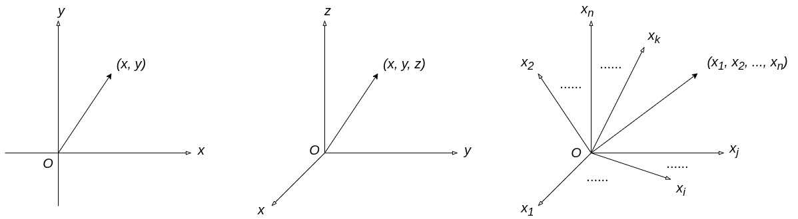

# Understanding and Implementing Embedding

Simply put, an Embedding is a high-dimensional vector representation of a Token.

When I first read this sentence, I was completely confused.

Why would a Token, something like a word, have anything to do with a high-dimensional space?

Why can a vector correspond to a Token?

How can we determine the value of each component of a vector from a Token alone?

Why represent a Token with a vector? Wouldn't a scalar or some other computable representation work?

## Vectors

To answer these questions, let's first understand what a vector is.

Looking back at 2003, I was a freshman in college, and my very first class was linear algebra.

I still remember my professor telling us that a vector is simply a matrix with either one row or one column. A matrix with one row is called a row vector, and a matrix with one column is called a column vector.

If that is all we know about vectors, no wonder that opening sentence sounds confusing.

But if we think a little more about what the professor said, we can see that a vector is, at its core, just a collection of numbers.

So anything that can be represented by a collection of numbers can be expressed as a vector. The coordinates of a point are one example.

A point on a plane can be represented by *(x, y)*. Those coordinates form a two-dimensional vector.

A point in three-dimensional space can be represented by *(x, y, z)*. Those coordinates form a three-dimensional vector.

By extension, a point in an *n*-dimensional space can be represented by $(x_1, x_2, \ldots, x_n)$. Those coordinates form an *n*-dimensional vector.

This brings us back to the opening sentence, "An Embedding is a high-dimensional vector representation of a Token." It means placing each Token at a point in an *n*-dimensional space. The coordinates of that point are the Token's Embedding.

But someone might ask: isn't a vector supposed to have both magnitude and direction? If we assign coordinates to each Token, where are its magnitude and direction?

That is easy to explain. The magnitude is the distance from the origin of the *n*-dimensional space to that point, and the direction is the direction from the origin toward that point.

Now the statement "An Embedding is a high-dimensional vector representation of a Token" makes sense. We can describe an Embedding either as the coordinates of a Token or as the corresponding vector in a high-dimensional space.

This leads directly to the next question: how can we determine each component of a Token's vector, or each coordinate of the Token's point, or each component of its Embedding, from the Token alone?

## A Shift in Thinking

When I was first learning AI, this question confused me for quite a while.

Almost every tutorial, article, or video I found seemed to say something along these lines:
- You can use the word2vec algorithm to turn Tokens into vectors.
- Turning Tokens into vectors is a process of maximizing *p(o|c)*.
- Once you have those vectors, you will discover something amazing: $v_{king} - v_{man} + v_{woman} \approx v_{queen}$.
- ...

After reading all that, I thought it was amazing, but I was even more confused.

My confusion came from a deeply ingrained assumption built up over years of engineering: if a system is structured as (Module 1) --> (Module 2), then (Module 1) must have a well-defined output before it can pass anything to (Module 2).

I eventually realized that in AI, or more specifically in neural networks (which underpin most modern AI models), multiple modules can participate in the same training process, and their parameters can be adjusted together as training proceeds.

That means each component of an Embedding vector can also be determined through training.

This is why, in the diagram from the first article, "[What Are the Main Components of a Complete LLM?](v0_01.md)", one of the arrows coming out of the Trainer module points back to Embedding.

In other words, we do not have to know the final values of every component of a Token's Embedding at the beginning. Instead, we gradually adjust them according to the training process. Once training is complete, their values are determined.

With this understanding, the implementation becomes quite simple. We only need to assign each Token a randomly generated vector during initialization and provide a way to adjust that vector during training.

Since every Token has a corresponding Embedding, it is natural to use its Token ID as an index for looking up the Embedding.

If Token IDs are consecutive integers, we can store all Embedding vectors compactly and access them directly by index. This offers significant advantages in both space and time.

This also answers the first question we left open in "[Understanding and Implementing a Tokenizer](v0_02.md)": why we assign consecutive integer Token IDs to all Tokens in the Token list.

For the implementation, see [/v0/embedding/embeddings.cpp](../v0/embedding/embeddings.cpp).

You may have noticed that the Embedding table is implemented as a matrix. Each row is an Embedding vector, and all the Embedding vectors together form a large matrix.

Why use a matrix instead of a plain array? I'll leave that question open for now. We will reveal the answer when we get to text generation with the Generator.

## How Semantics, Grammar, and Embedding Relate

There are still two questions we have not answered.

The first is the last question from the beginning of this article: why use a vector to represent a Token? Wouldn't a scalar or some other computable representation work?

The second comes from "[What Are the Main Components of a Complete LLM?](v0_01.md)", where I said that Embedding carries semantic information associated with a Token and may also contain grammatical, morphological, and other linguistic features. How can a vector carry these features, and how can it be associated with them?

In fact, these are two sides of the same question.

To understand the answer, we need to think about what an *n*-dimensional space and the vectors (or coordinates, which we will treat as equivalent here) within it can mean. Let's use an example.

Let *n* = 3. Imagine a three-dimensional space that represents Tokens referring to different fruits.

*x* axis: represents whether the fruit is round or elongated, with values from 0 to 1. A value closer to 0 means rounder, while a value closer to 1 means more elongated.

*y* axis: represents whether the fruit is red or yellow, with values from 0 to 1. A value closer to 0 means redder, while a value closer to 1 means yellower.

*z* axis: represents the size of the fruit's seeds, with values from 0 to 1. A value closer to 0 means smaller seeds, while a value closer to 1 means larger seeds.

Now we can represent a few fruit Tokens as Embedding vectors in this illustrative three-dimensional space.

| Token | Embedding | Semantics |
| --- | --- | --- |
| Apple | [0.12, 0.07, 0.33] | Fairly round, red, with relatively small seeds |
| Orange | [0.04, 0.51, 0.26] | Very round, orange-colored, with relatively small seeds |
| Banana | [0.92, 0.99, 0.01] | Very elongated, yellow, with almost no seeds |
| Yellow peach | [0.11, 0.64, 0.94] | Fairly round, yellowish, with a very large pit |

By extension, as we add more axes (also called dimensions or components; I will use these terms interchangeably from here on) to represent semantics, we have the opportunity to describe more semantic features of a Token with more numerical values, giving us a richer semantic representation.

The same idea applies to grammar. Suppose we have an *n*-dimensional space representing all verbs, and one dimension represents tense. Then "have" and "had" could express their difference in tense through different values along that dimension.

Keep in mind that these are analogies meant to help us understand the idea. Real Embedding spaces have many dimensions. GPT-2, for example, uses 768 dimensions, and many larger language models use even more. We cannot necessarily tell what each learned dimension represents. Some dimensions may develop distinctive features during training, but those features might not even have meanings that humans can readily understand. Since our ability to understand high-dimensional spaces is limited to begin with, there is no need to get too caught up in what each individual dimension means. These examples simply illustrate the relationship between Embedding and linguistic features such as semantics and grammar. They also help explain what I meant in "[What Are the Main Components of a Complete LLM?](v0_01.md)" when I said that the Embedding module helps the model understand what words refer to.

## Position Embedding

If you have already looked at the implementation in [/v0/embedding/embeddings.cpp](../v0/embedding/embeddings.cpp), you may have noticed that there are two Embeddings.

One is Token Embedding, which is what we have been discussing so far.

The other is called Position Embedding.

So what does Position Embedding mean? I'll leave that as another question for now. The answer will become clear when we implement the Transformer.

## Summary

Let's end with the same sentence we started with: an Embedding is a high-dimensional vector representation of a Token. This article has been about making sense of that sentence.

In the world of neural networks, we do not need to train each module independently before passing its output to the next module. Multiple modules can be trained jointly, and their parameters can be adjusted throughout training.

Implementing Embedding involves randomly initializing vectors, looking them up by Token ID, and providing a way to adjust them during training.

As for the word2vec algorithm, *p(o|c)*, and $v_{king} - v_{man} + v_{woman} \approx v_{queen}$ that confused me earlier, they no longer stand in the way of moving forward. They are still questions worth understanding, though. I will write a bonus article to explain them. It will not be required for the main series, so feel free to skip it if you are not interested.

Next up is the Transformer, the core of an LLM.

The Transformer is a big topic. There is no way to explain it all in one article, so we will take our time and explore it across several articles.
