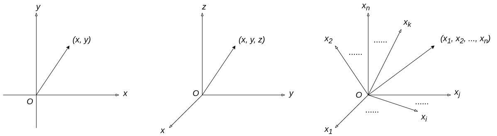

# Embedding：理解与实现

简而言之，Embedding 就是 Token 的高维空间向量表示。

我第一次看到这句话的时候，是很懵的。

为什么一个 Token，类似于一个词，会和高维空间扯上关系？

为什么一个向量可以和一个 Token 对应呢？

向量中的每个分量值单凭一个 Token 如何确定呢？

为什么要用向量来表示 Token 呢？标量或者其他可计算的表示方式不行吗？

## 向量

想要回答这些问题，我们先来弄清楚什么是向量。

回望 2003 年，还是大一新生的我，大学的第一堂课，就是线性代数。

我到现在还记忆犹新，老师告诉我们，向量就是行或者列数为 1 的矩阵。行数为 1 的矩阵就叫行向量，列数为 1 的矩阵就叫列向量。

如果只是这么理解向量，那么，难怪看到那句“简而言之”的时候，会发懵。

但仔细想想老师说的话，不难发现，向量的本质无非就是一组数。

因此，任何能用一组数来表示的东西，都可以叫做向量，比如，点的坐标。

平面上一个点的坐标，可以用 *(x, y)* 来表示，这个点的坐标就是一个二维向量。

三维空间中一个点的坐标，可以用 *(x, y, z)* 来表示，这个点的坐标就是一个三维向量。

推而广之，*n* 维空间中一个点的坐标，可以用 $`(x_1, x_2, \ldots, x_n)`$ 来表示，这个点的坐标就是一个 *n* 维向量。

因此，本文开头的那句话，“Embedding 就是 Token 的高维空间向量表示”，就是把每一个 Token 放在 *n* 维空间中的一个点上，这个点的坐标就是该 Token 的 Embedding。

或许有人会问，向量难道不是既有大小又有方向的量吗？如果给每个 Token 找一个坐标，那大小和方向在哪儿呢？

这并不难解释，大小就是 *n* 维空间的原点到这个坐标的距离，方向就是 *n* 维空间的原点和这个坐标的连线方向。

如此一来，“Embedding 是 Token 的高维空间向量表示”这句话就解释通了。Embedding 也就可以既说成是 Token 的坐标，也说成是 Token 对应的高维空间向量了。

那么紧接着下一个问题就来了，Token 向量中的每个分量，或者叫做 Token 坐标的每个坐标分量，或者叫做 Embedding 的每个分量，单凭一个 Token 如何确定呢？

## 思维需要一个转变

对于这个问题，当时初学 AI 的我，也糊涂了许久。

我找到的几乎所有的教程，材料，视频，大概率都说过类似的话：
- 用 word2vec 算法就可以把 Token 变成向量了；
- 把 Token 变成向量的过程就是最大化 *p(o|c)* 的过程；
- 变成向量之后，你会发现很神奇的东西：$`v_{king} - v_{man} + v_{woman} \approx v_{queen}`$；
- ......

看完这些之后，我的感觉就是，确实很神奇，但也更糊涂了。

这种糊涂基于多年以来一个顽固的认知：如果系统模块结构是 (Module 1) --> (Module 2)，那么 (Module 1) 必须要有自己确定的输出，才能交给 (Module 2) 使用。

后来才明白，在 AI，或者说神经网络（现代 AI 基本上都是基于神经网络模型）的世界里，多个模块可以共同参与同一个训练过程，它们的参数可以随着训练一起调整。

因此，Embedding 向量中的每个分量，也可以通过训练来确定。

这也就是第一篇“[一个完整的 LLM 由哪些部分组成](v0_01.zh_CN.md)”里面看到的那张图，Trainer 模块后续的其中一个箭头是指向了 Embedding 的。

也就是说，我们没有必要一开始就确定这个 Token 所对应 Embedding 向量的所有分量值，而是在训练中根据规则逐渐调整它们，训练完成之后，它们的值也就确定了。

基于这样的理解，实现起来就很简单了。我们只需要在初始化的时候，给每一个 Token 指定一个随机生成的向量，并提供在训练过程中调整的能力即可。

既然每个 Token 都对应一个 Embedding，很自然地，Token ID 就可以作为通过 Token 查找 Embedding 的索引。

很显然，如果 Token ID 是连续的整数，那么所有的 Embedding 向量都可以做紧凑存储和直接下标查找。这样，无论在空间还是时间上，都有很大的优势。

这也就把我们在“[Tokenizer 的原理与实现](v0_02.zh_CN.md)”中卖的第一个关子，即“为 Token 列表中的所有 Token 选择连续整数的 Token ID”，说清楚了。

具体实现参见 [/v0/embedding/embeddings.cpp](../v0/embedding/embeddings.cpp)。

可能你已经注意到，在实现代码中，Embedding 的表是用矩阵实现的。每一行是一个 Embedding 向量，所有的 Embedding 向量组成了一个大矩阵。

为什么要用矩阵而不是直接用数组呢？这里再卖一个关子，我们会在生成文本（Generator）那里，揭晓答案。

## 语义、语法和 Embedding 的关系

还有两个问题没有回答。

第一个问题，是本篇开头所列的最后一个问题：为什么要用向量来表示 Token 呢？标量或者其他可计算的表示方式不行吗？

第二个问题，前文“[一个完整的 LLM 由哪些部分组成](v0_01.zh_CN.md)”里面说，Embedding 承载与 Token 相关的语义信息，也可能包含语法、词形等其他语言特征。那么，一个向量怎么承载这些特征？怎么和这些特征建立联系的呢？

其实，这两个问题是同一个问题。

这就涉及到这个 *n* 维空间，以及在其中的向量（或者坐标，意思相同，后文不再特殊标注）是什么含义了。我们举个例子来说明。

我们令 *n* = 3，这个三维的举例空间，代表的含义是，表示所有水果的 Token。

*x* 轴：表示该 Token 代表的水果是圆形还是长形，取值 0 到 1 之间，越接近 0 表示形状越圆，越接近 1 表示形状越长。

*y* 轴：表示该 Token 代表的水果是红色还是黄色，取值 0 到 1 之间，越接近 0 表示颜色越红，越接近 1 表示颜色越黄。

*z* 轴：表示该 Token 代表的水果是否有明显的种子，取值 0 到 1 之间，越接近 0 表示种子越小，越接近 1 表示种子越大。

那么，我们就可以把以下这几个代表水果的 Token 转化成这个三维举例空间中的 Embedding 向量了。

| Token | Embedding | 语义 |
| --- | --- | --- |
| 苹果 | [0.12, 0.07, 0.33] | 较圆，红色，种子相对小的水果 |
| 橙子 | [0.04, 0.51, 0.26] | 很圆，橙色，种子相对小的水果 |
| 香蕉 | [0.92, 0.99, 0.01] | 很长，黄色，几乎没有种子的水果 |
| 黄桃 | [0.11, 0.64, 0.94] | 较圆，偏黄，种子很大的水果 |

推而广之，随着表示语义的坐标轴（或者叫做维度/分量，后文混用，不再说明）增加，我们就有机会用更多的数值来描述 Token 的不同语义特征，从而获得更丰富的语义表示。

语法也是一样的，假如我们有一个表示所有动词的 *n* 维空间，其中一个维度表示时态，那么，“have”和“had”就可以通过这个维度上的差异来表达时态的不同。

需要指出的是，这只是一个类比的，帮助理解的例子。真正的 Embedding 空间的维度很高，比如 GPT-2 就有 768 维，许多更大规模的语言模型使用的维度还要更高。我们无法知道每个维度训练出来具体指代什么意思。有些维度在训练过程中形成了显著的特征，但该维度可能根本没有人类可以理解的定义。加上人类对高维空间的理解本就非常有限，因此我们也不必过度纠结于每个维度的具体含义。以上举例仅仅说明 Embedding 和语义、语法等语言特征的相关性，也是给前文“[一个完整的 LLM 由哪些部分组成](v0_01.zh_CN.md)”中提到的“明白这些词语指代的意思，由 Embedding 模块实现”这句话做出一个解释。

## Position Embedding

如果你已经看完了实现代码 [/v0/embedding/embeddings.cpp](../v0/embedding/embeddings.cpp)，会发现有两个 Embedding。

一个是 Token Embedding，我们在上文说的都是它。

另外一个叫做 Position Embedding。

这个 Position Embedding 又是什么意思呢？这里还是先卖个关子，等我们到了实现 Transformer 的时候，自然会揭晓。

## 总结

还拿这句话来总结好了。简而言之，Embedding 就是 Token 的高维空间向量表示。本篇就是把这句话解释清楚了。

在神经网络的世界里，我们不必要求每个模块先独立完成训练，再交给下一个模块使用。多个模块可以联合训练，参数也可以在训练过程中不断调整。

Embedding 的实现就是一个简单的随机初始化和用 Token ID 查表的过程，并提供在训练过程中调整的能力。

至于前面所说的让人糊涂的 word2vec，*p(o|c)*，$`v_{king} - v_{man} + v_{woman} \approx v_{queen}`$ 这些，已经不是我们继续前进的阻碍了，但这些依然是需要想明白的问题。我会加一个关于它们的番外篇来解释清楚。番外篇不影响主线，如果没有兴趣，可以跳过。

接下来就该进入 Transformer 了，LLM 中最核心的部分。

Transformer 是一盘大餐，不可能用一篇就讲明白。我们会分成许多篇，细细道来。
