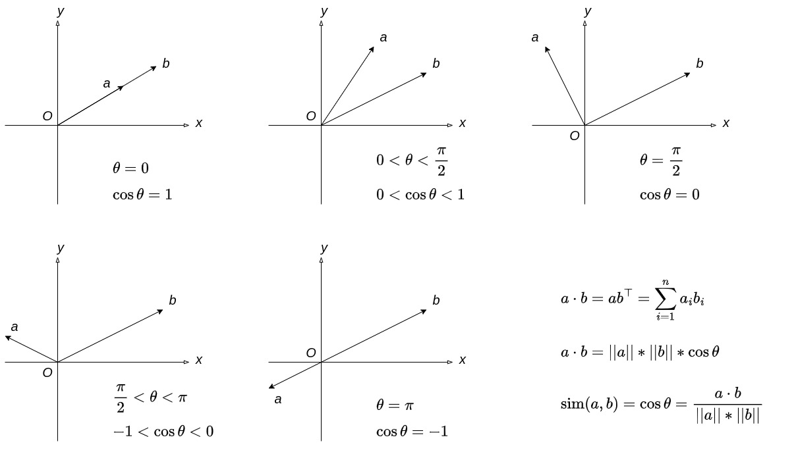
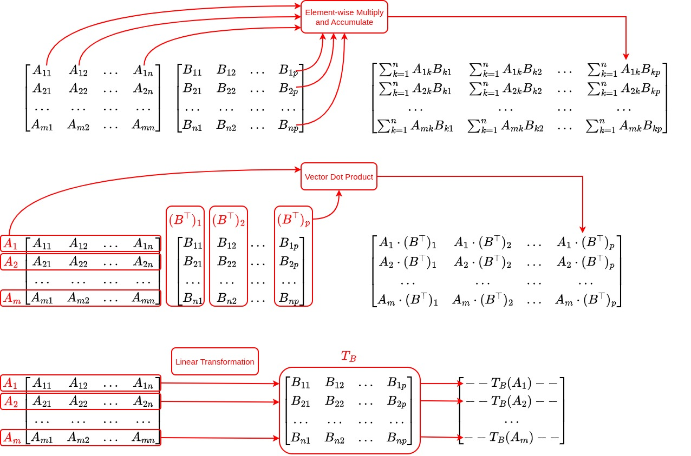

# Vector Dot Products, Linear Transformations, and Matrix Multiplication

Starting with this article, we are officially entering the core of LLMs: the Transformer.

Matrix operations are among the most important and common operations in a Transformer.

And among matrix operations, matrix multiplication is the most fundamental.

In a Transformer, matrix multiplication often represents vector dot products or linear transformations.

In this article, we'll clarify these basic concepts and provide an implementation of basic matrix operations.

Given the limited space, we can't start from the very beginning of linear algebra.

I'll assume you already have a basic understanding of linear algebra, including what matrices and vectors are and how to add and multiply them.

If you feel your linear algebra foundation could use some work, I strongly recommend [MIT 18.06 Linear Algebra](https://www.youtube.com/playlist?list=PLE7DDD91010BC51F8).

All right, let's get started.

## Vector Dot Products

### A Convention First

Before we begin, let's establish a convention for this and all subsequent articles: unless otherwise specified, the word "vector" refers to a **row vector**: a vector with one row and multiple columns, or a $`1 \times n`$ vector.

This differs from the convention in many linear algebra textbooks, where vectors are usually treated as column vectors by default.

Why use row vectors here? Because our ultimate goal is not just to understand these operations, but also to implement them. In our implementation, both vectors and matrices (a vector is also a kind of matrix) generally use row-major storage.

Row-major storage is also fairly intuitive to think about.

With this storage layout, treating the rows of a matrix as vectors allows us to load and process contiguous data, which is friendly to CPU caches.

That's because CPUs tend to load contiguous regions of memory into the cache.

If we instead treat the columns of a row-major matrix as vectors, loading one such vector requires jumping between noncontiguous memory locations. This is less cache-friendly and can lead to significant performance penalties in large-scale computations.

So, from now on, when we say "vector *a*," we mean the row vector *a*. We use $a^{\top}$ to denote the corresponding column vector.

### What Does a Dot Product Mean?

Given two *n*-dimensional vectors $a$ and $b$, their dot product is defined as:

$$ a \cdot b = \sum_{i=1}^{n} a_{i}b_{i} = ab^{\top} $$

The computational meaning is straightforward: multiply the corresponding components of the two vectors and add up the products.

But what does it mean geometrically?

To answer that, let's first look at the length, or magnitude, of a vector.

As discussed earlier, the length of a vector is the distance from the origin to the point represented by its coordinates. Suppose we have:

$$ a = (a_1, a_2, ..., a_n) $$

By the distance formula, the length (also called the magnitude; we'll use the two terms interchangeably) is:

$$ \lVert a \rVert = \sqrt{\sum_{i=1}^{n} a_{i}^2} $$

Now that we know the length of a vector, we can express the dot product in terms of vector lengths:

$$ a \cdot b = \lVert a \rVert \lVert b \rVert \cos\theta $$

Here, $\theta$ is the angle between vectors $a$ and $b$.

The two formulas for the dot product are equivalent, and this can be proved rigorously. We'll skip the proof here. If enough readers are interested, please let me know. I might write a bonus article to walk through it in detail.

This length-based formula gives the dot product a geometric interpretation: multiply the lengths of the two vectors, then multiply by the cosine of the angle between them.

The cosine of the angle between two vectors is also called their **cosine similarity**. If the vectors point in the same direction, then $\theta = 0, \cos\theta = 1$, giving the highest cosine similarity.

If the vectors are perpendicular, then $\theta = \frac{\pi}{2}, \cos\theta = 0$. Their cosine similarity is zero, and the vectors are orthogonal. Naturally, two orthogonal vectors $a$ and $b$ also satisfy $ab^{\top} = 0$.

If the vectors lie on the same line but point in opposite directions, then $\theta = \pi, \cos\theta = -1$, representing the strongest possible opposition in direction.

In this geometric sense, cosine similarity represents the relationship between the directions of two vectors.

Therefore, we can think of the dot product as the product of this directional relationship and the lengths of the two vectors. It is one way to measure a similarity relationship between vectors.

## Linear Transformations

A transformation $T$ is called a **linear transformation** if it satisfies:

$$ T(v_1 + v_2) = T(v_1) + T(v_2) $$

and

$$ T(cv) = cT(v) $$

where $c$ is a scalar.

For example, $T(x) = 2x$ is a linear transformation because $T(a + b) = 2(a + b) = 2a + 2b = T(a) + T(b)$, and $T(ca) = 2ca = c \times 2a = cT(a)$.

When $v_1$, $v_2$, and $v$ are vectors, $T$ is a linear transformation of vectors. That's the kind of linear transformation we'll focus on here.

There is an important result: for any linear transformation on a finite-dimensional vector space, once the coordinate systems are fixed, there is a unique matrix $W$ such that, for every vector $v$,

$$ T(v) = vW $$

In other words, once we've found the matrix $W$, we can implement the linear transformation $T(v)$ simply by computing $vW$.

Why is this true? Same deal as before: let me know if you're interested. If enough people ask, we'll make it a bonus article. Hehe.

Here's a simple example. Let $v = [x, y]$, and suppose $T(v) = T([x, y]) = [2x, 3y]$. The corresponding matrix is:

$$ W = \begin{bmatrix} 2 & 0 \cr 0 & 3 \end{bmatrix} $$

Clearly, $T(v) = vW$.

## Matrix Multiplication

### Three Ways to Understand It

You probably remember how matrix multiplication was taught in linear algebra class. First, you were given a rather intimidating formula:

$$ C_{m \times p} = A_{m \times n}B_{n \times p} \implies C_{ij} = \sum_{k=1}^{n} A_{ik}B_{kj} $$

Then you learned two ways to carry out the computation: multiplying and accumulating along columns or along rows.

When I first started learning AI, this was pretty much the extent of my understanding of matrix multiplication. As I went further, things became increasingly tiring, because whenever I encountered matrix multiplication, my brain would automatically try to interpret it through that element-by-element formula.

There's nothing wrong with this way of thinking: it treats each element as the basic unit of computation. But I believe a more mature understanding of matrix multiplication shouldn't stop there.

If we instead treat vectors as the basic units, we get several other ways to understand matrix multiplication. Personally, I find the following two perspectives much easier to work with when learning AI.

**First perspective:** In the matrix multiplication $C = AB$, each element of $C$ is the dot product of a vector from $A$ (following our earlier convention, an unspecified vector means a row vector) and a **column** vector from $B$ (that is, a vector from $B^{\top}$).

$$ C_{m \times p} = A_{m \times n}B_{n \times p} \implies C_{ij} = A_{i} \cdot (B^{\top})_{j} $$

**Second perspective:** In the matrix multiplication $C = AB$, each vector in $C$ is the result of applying the linear transformation represented by $B$ to the corresponding vector in $A$.

$$ C_{m \times p} = A_{m \times n}B_{n \times p} \implies C_{i} = A_{i}B $$

Clearly, all three ways of understanding matrix multiplication produce exactly the same result.

Of course, these aren't the only ways to think about matrix multiplication. But for those of us just getting started with LLMs, these three perspectives should be enough to move forward.

### Implementing Matrix Multiplication

There may be many ways to understand matrix multiplication, but in our V0 implementation, we ultimately compute it element by element.

See the implementation in [/v0/common/matrix.cpp](../v0/common/matrix.cpp).

Other matrix operations, including addition, Hadamard multiplication (element-wise multiplication, just like element-wise addition), and transposition, are implemented in the same file.

During implementation, I spent some time debating how to store a matrix: should I use one contiguous block of memory in row-major order, or allocate a separate memory region for each row?

After thinking it through several times and discussing it with ChatGPT, I ultimately chose a single contiguous block of memory with row-major storage.

There were two reasons. First, cleaning up the heap allocation requires only one `delete` operation. Second, contiguous storage may make subsequent CPU/GPU cache optimizations easier.

## Summary

There are three key takeaways from this article:

First, the geometric meaning of the vector dot product: it provides one way to measure the similarity relationship between two vectors. It can be computed as $a \cdot b = ab^{\top}$.

Second, every linear transformation of vectors corresponds to a unique matrix once the coordinate systems are fixed. Multiplying a vector by that matrix gives the result of the linear transformation.

Third, three ways to understand matrix multiplication: the element-by-element formula, pairwise vector dot products, and applying a linear transformation to each vector in a matrix.

Compared with these concepts, the implementation code itself almost seems less important. Haha.

This article may look like pure mathematics, and perhaps a little dry, but every point matters.

To understand these ideas myself, I spent nearly two months of commuting time relearning linear algebra, using the very MIT lectures recommended at the beginning of this article.

That's why I wanted to put everything together and share it here: I hope you won't have to take the same detours I did. This is **not** a bonus article, so please don't skip it. Take the time to understand these concepts and ways of thinking thoroughly.

Before we dive into the actual computations inside a Transformer, a solid understanding of these ideas will be one of our most useful tools for tackling the challenges ahead.
