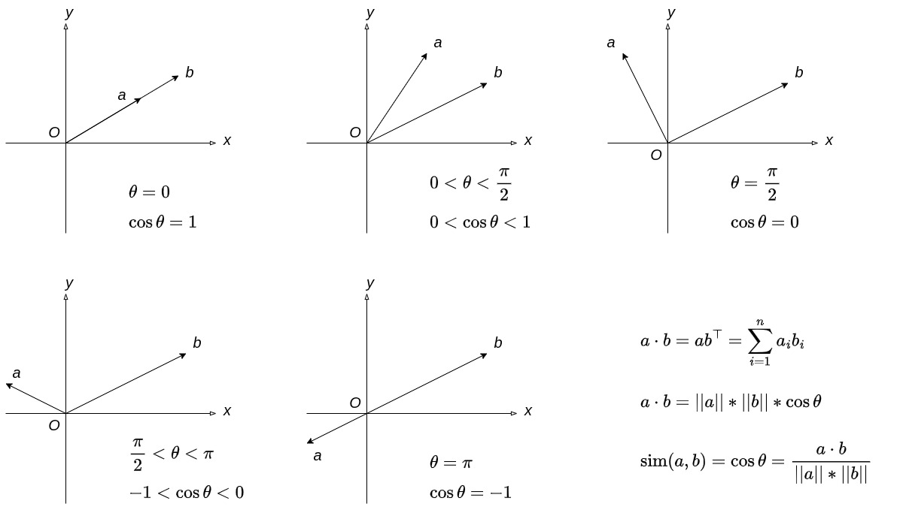
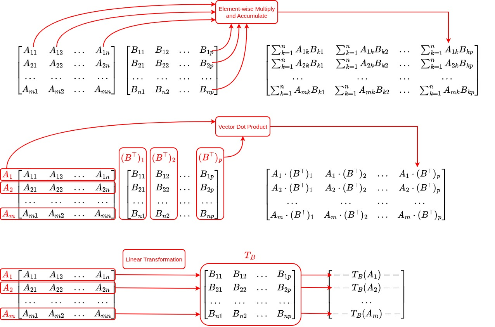

# 向量点积、线性变换与矩阵乘法

从本篇开始，我们正式进入 LLM 的核心区域 —— Transformer。

Transformer 中，最重要和常见的运算就是矩阵运算。

而在矩阵运算中，最核心的是矩阵乘法。

矩阵乘法在 Transformer 中，大多数时候表示的是向量点积和线性变换。

本篇我们就把这些基本概念说清楚，同时给出基本矩阵运算的实现。

由于篇幅所限，我们不可能从基础的线性代数一点一点讲起。

我会假设你已经拥有基本的线性代数能力，包括理解矩阵和向量的概念，明白如何做矩阵和向量的加法和乘法。

如果你觉得基本线性代数能力还有所欠缺，我强烈推荐去看这个视频集：[MIT 18.06 Linear Algebra](https://www.youtube.com/playlist?list=PLE7DDD91010BC51F8)，带有中文翻译字幕的在[这里](https://www.youtube.com/playlist?list=PL9-YEw8bQat39-XI7g20blDYFGTuh7ofB)。

好，那我们就开始。

## 向量点积

### 约定在先

在开始之前，我们需要约定一下，对于以后所有篇目，如果不做特殊说明，“向量”这个词，都是指行向量，即单行多列的向量，或者叫做 $`1 \times n`$ 向量。

这和一般的线性代数教材是不一样的。在大部分线性代数学科教材里，说到“向量”，大多数会默认是列向量。

为什么在这里要默认行向量呢？因为我们最终目的是理解并实现，而实现的时候，无论是向量还是矩阵（其实向量也是一种矩阵），一般采用行优先存储。

行优先存储对于人的传统思维来说，是比较好理解的。

在这种存储方式下，如果向量是行向量，则每次从一个矩阵中，以向量为单位进行加载和计算，对 CPU 的缓存比较友好。

对缓存友好的原因是，CPU 做缓存加载的时候，倾向于加载连续内存空间到缓存中。

如果此时默认向量是列向量，在行优先存储的方式下，从矩阵中加载一个向量需要从不连续的内存空间中跳跃读取，对缓存不友好。大规模运算时，性能损耗会比较严重。

因此，这里我们约定好，如果说“向量 *a*”，则指代的是行向量 *a*。对于列向量，我们采用 $`a^{\top}`$ 表示。

### 点积的含义

有 $`a`$ 和 $`b`$ 两个 *n* 维向量，定义向量 $`a`$ 和 $`b`$ 的点积为：

$$ a \cdot b = \sum_{i=1}^{n} a_{i}b_{i} = ab^{\top} $$

直接含义固然好理解，即两个向量中所有分量对齐下标，分别相乘再相加。

那么，它的几何意义呢？

这个问题，我们先要看一下什么是向量的长度，或者叫做向量的模长。

向量的长度，我们在上一节中说过，就是向量对应的坐标点到原点的距离。显然，假如向量

$$ a = (a_1, a_2, ..., a_n) $$

则根据空间中点的距离公式，向量的长度（也叫做模长，意思相同，后文自由替换）为

$$ \lVert a \rVert = \sqrt{\sum_{i=1}^{n} a_{i}^2} $$

有了向量的长度，我们就可以用向量的长度来定义点积了。

$$ a \cdot b = \lVert a \rVert \lVert b \rVert \cos\theta $$

其中 $`\theta`$ 是向量 $`a`$ 和 $`b`$ 之间的夹角。

以上两个点积的定义式是等价的，可以严格证明。具体证明过程，这里就略去了。有兴趣的读者可以告诉我，如果人数不少，我可以考虑开一个番外篇来做详细证明。

这个基于向量长度的定义式就有几何意义了，是指两个向量的长度相乘，再乘以其夹角的余弦值。

两个向量的夹角余弦值，也可以叫做两个向量的“余弦相似度”，显然，如果两个向量方向相同，则 $`\theta = 0, \cos\theta = 1`$ ，余弦相似度最高。

如果两个向量垂直，则 $`\theta = \frac{\pi}{2}, \cos\theta = 0`$ ，余弦相似度为 0，是正交向量。显然，两个正交向量 $`a`$ 和 $`b`$ 也满足 $`ab^{\top} = 0`$ 。

如果两个向量在同一直线上且方向相反，则 $`\theta = \pi, \cos\theta = -1`$ ，余弦相似度为反向最高。

这个意义上，余弦相似度代表了向量的相关性。

因此，点积就可以看成两个向量的相关性和两个向量长度的乘积。它是两个向量相似关系的一种度量。

## 线性变换

如果有一个变换 $`T`$ ，满足

$$ T(v_1 + v_2) = T(v_1) + T(v_2) $$

和

$$ T(cv) = cT(v) $$

其中，$`c`$ 是一个数，则这个变换 $`T`$ 就叫做线性变换。

举个例子，$`T(x) = 2x`$ 就是一个线性变换，因为 $`T(a + b) = 2(a + b) = 2a + 2b = T(a) + T(b)`$，且 $`T(ca) = 2ca = c \times 2a = cT(a)`$。

如果其中 $`v_1`$，$`v_2`$，$`v`$ 是向量，那么 $`T`$ 就是对向量的线性变换。我们这里只关注对向量的线性变换。

对于向量的线性变换，有这么一个结论：任何一个对有限维度向量 $`v`$ 的线性变换，在选定的坐标系下，必然能找到唯一确定的矩阵 $`W`$，使得对于任意向量 $`v`$，都有 $`T(v) = vW`$。

也就是说，找到了这个矩阵 $`W`$，也就可以用 $`vW`$ 的方式，实现线性变换 $`T(v)`$ 了。

至于这个结论为什么成立，还是刚才的老规矩，有兴趣就告诉我，人数多了就开番外篇，嘿嘿。

举个向量和矩阵的例子，$`v = [x, y]`$，$`T(v) = T([x, y]) = [2x, 3y]`$，则其对应的矩阵

$$ W = \begin{bmatrix} 2 & 0 \cr 0 & 3 \end{bmatrix} $$

显然 $`T(v) = vW`$。

## 矩阵乘法

### 三种理解方法

相信你一定还记得学习线性代数的时候，老师是怎么教矩阵乘法的。首先给出一个让人发晕的式子：

$$ C_{m \times p} = A_{m \times n}B_{n \times p} \implies C_{ij} = \sum_{k=1}^{n} A_{ik}B_{kj} $$

然后，再告诉你两种计算的方法：“列扫描对乘加”和“行扫描对乘加”。

我刚刚开始学习 AI 的时候，对矩阵乘法的理解就停留在这里。于是，越学觉得越累，因为大脑总是不自觉地，对任何地方出现的，和矩阵乘法相关的东西，像这样解释一遍。

这种理解，是把每个元素当成基本单位来理解。当然，这是完全没错的。但对于矩阵乘法，我认为，成熟的思维中，不应该只有这一种理解方法。

如果我们把向量当成基本单位来理解，那么就可以有多种理解方法。以下两种理解方法，个人认为对学习 AI 来说，更加轻巧便捷。

第一种：矩阵乘法 $`C = AB`$，$`C`$ 中的每个元素是 $`A`$ 中的每个向量（遵从前文约定，未特别说明的向量均为行向量）和 $`B`$ 中的每个**列**向量（即 $`B^{\top}`$ 中每个向量）的点积。

$$ C_{m \times p} = A_{m \times n}B_{n \times p} \implies C_{ij} = A_{i} \cdot (B^{\top})_{j} $$

第二种：矩阵乘法 $`C = AB`$，$`C`$ 中的每个向量是 $`A`$ 中的每个向量通过 $`B`$ 这个线性变换之后的结果。

$$ C_{m \times p} = A_{m \times n}B_{n \times p} \implies C_{i} = A_{i}B $$

显然，以上三种理解方法，最终结果上是完全等价的。

需要指出的是，对矩阵乘法的理解方法，并不止这三种。但是，对初学 LLM 的我们来说，这三种应该足够继续往下推进了。

### 矩阵乘法的实现

理解上固然方法很多，但在 V0 实现当中，我们还是最终落到针对每个元素的计算。

具体实现参见 [/v0/common/matrix.cpp](../v0/common/matrix.cpp)。

其他矩阵运算，包括加法，Hadamard 乘法（和加法模式相同的，逐元素对应下标乘法），以及转置，也在同一个文件当中实现。

在实现过程中，我曾经纠结于矩阵的存储，是使用一块连续的空间做行优先存储，还是真正让每行成为独立的存储区域呢？

思考几轮，加上和 ChatGPT 讨论之后，最终我还是决定使用一块连续空间 + 行优先存储的方法来做。

原因有两个，一是堆空间清理的时候只需要执行一次 `delete` 操作；二是后续优化的时候，连续存储的空间可能更加有利于后续的 CPU/GPU 缓存优化。

## 总结

本篇有几个关键点：

第一，向量点积的几何意义，是两个向量的相似关系的一种度量。其计算方法是 $`a \cdot b = ab^{\top}`$。

第二，每个对向量的线性变换，在选定的坐标轴下，都对应一个唯一的矩阵。向量与该矩阵的乘积就是线性变换的结果。

第三，矩阵乘法的三种理解方法：元素计算公式，两两向量点积，以及对矩阵中每个向量的线性变换。

至于实现代码本身，倒显得不那么重要了，哈哈。

本篇看起来像是纯数学的东西，相对枯燥，但每个点都很重要。

为了理解这些，鄙人用了将近两个月的上下班通勤时间，重新学了一遍线性代数，用的就是本文开头推荐的视频。

因此，专门整理一篇分享给大家，也是希望大家不要再走一遍我的弯路。本篇不是番外篇，请大家不要跳过，扎扎实实地掌握住这些知识点和理解方式。

在真正开始 Transformer 计算流程之前，对以上内容扎实的理解，就是我们后面一路过关斩将的利器。
